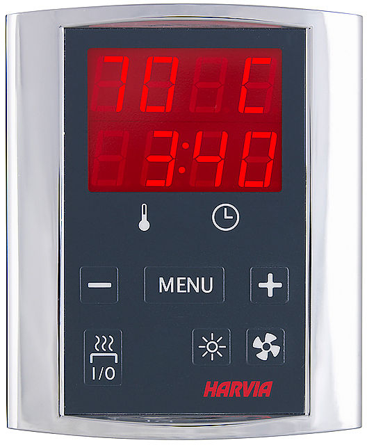
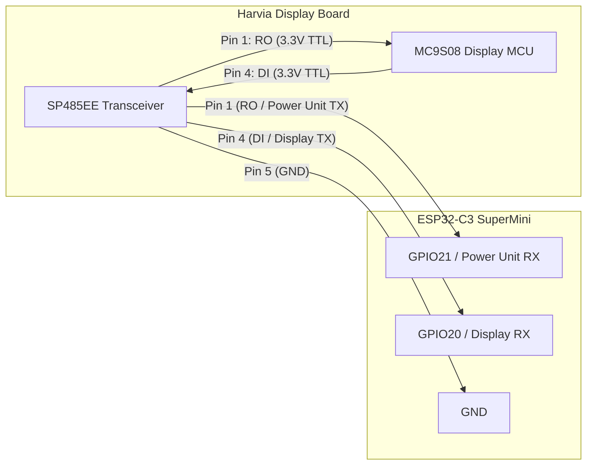

# Harvia Griffin CG170 Sauna Controller (ESPHome MitM & Telemetry)

[](https://esphome.io/)
[](https://www.home-assistant.io/)
[](https://www.espressif.com/)
[](#protocol-overview)
[](LICENSE)

An open-source ESPHome implementation for monitoring and interfacing with the **Harvia Griffin CG170** digital sauna control unit.

<p align="center">
  
  <br>
  <em>Harvia Griffin CG170 Digital Control Panel (Model CG170400 / Panel WX350)</em>
</p>

---

## ⚠️ Important Disclaimer & Safety Notice

> [!WARNING]
> **DELIVERED WITHOUT ANY WARRANTY OR GUARANTEES ("AS IS")**
> This repository is an experimental, hobbyist reverse-engineering project developed with AI assistance. It is provided strictly for educational and research purposes.
>
> * **Personal Responsibility:** Any modifications, wiring, or connections you make to your sauna hardware are performed entirely at your own risk.
> * **Electrical Safety:** Working on this project is **relatively safe** because all physical connections are made solely to the **low-voltage 12V DC power / 3.3V logic cable** between the display unit and power unit. **NEVER touch or open the 230V / 400V 3-phase mains compartment inside the main power unit or heater.** High voltage can cause severe electric shock or death.
> * **Fire & Sauna Safety:** Saunas generate extreme heat. Never bypass factory safety switches, overheat cutouts, or temperature fuses. Ensure the sauna is empty and free of flammable items before any heating cycle.

---

## 🎯 Project Goals & Current Status

### The Ultimate Goal: Man-in-the-Middle (MitM) Control
The long-term objective of this project is a full inline **Man-in-the-Middle (MitM)** controller placed between the main Harvia CG170 power switchboard and the wall-mounted user display to provide:
1. **Full Home Assistant Remote Control:** Start, stop, set sauna temperature, and schedule heating cycles remotely.
2. **Error Filtering (The "E9" Fix):** Intercept and filter spurious `E9` communication failure packets before they trigger an error on the display.
3. **Display Transparency:** Keep the physical wall display 100% operational with synchronized state changes.

### 📍 Where the Project Is Today
> [!IMPORTANT]
> **The project is NOT at full active MitM injection yet.**
>
> Currently, the repository provides a **fully operational, tested, dual-channel passive sniffer & real-time telemetry bridge**:
> * ✅ **Live Sauna Temperature** decoded directly from bus packets.
> * ✅ **Target Setpoint Temperature** captured in real-time.
> * ✅ **Sauna Remaining Timer** decoded in minutes.
> * ✅ **Relay Status** (Heater, Light, Fan) tracked via bus telemetry.
> * ✅ **Diagnostic Sensors** (Bus connectivity, state synchronization mismatch, ESP32 memory).
> * ✅ **Rate-Limited Home Assistant Sync** (prevents flooding your Home Assistant database while keeping internal states instant).
>
> Active packet injection and packet alteration (true MitM) are the next development milestone.

---

## 🖥️ The Controller Display Interface

The Harvia Griffin CG170 control panel (spare part `WX350` / board `SK038972`) features a segmented LED display with tactile touch keys:

```text
       +-----------------------------------+
       |            HARVIA GRIFFIN         |
       |  +-----------------------------+  |
       |  |   [ 80 C ]  Current / Set   |  |  <- Upper LED Display
       |  |   [ 3:40 ]  Timer Remaining |  |  <- Lower LED Display
       |  +-----------------------------+  |
       |         [Temp]        [Clock]     |  <- Status Indicators
       |                                   |
       |   [ - ]        [MENU]      [ + ]  |  <- Parameter Adjustments
       |                                   |
       |   [ I/O ]      [Light]     [Fan]  |  <- Device Control Buttons
       |   (Heater)                        |
       +-----------------------------------+
```

* **Upper Display:** Displays current sauna temperature (e.g. `78°C`) during operation, or target setpoint when adjusting.
* **Lower Display:** Displays remaining operating time (hours:minutes) or delay timer.
* **Buttons:**
  * **Heater I/O (`0x22` / `0x23`):** Toggles main heating contactors on/off.
  * **Light (`0x3C`):** Toggles sauna lighting relay on/off.
  * **Fan (`0x32`):** Toggles ventilation fan relay on/off.
  * **MENU / `+` / `-`:** Enters parameter menus and adjusts values.

---

## 🏷️ Supported Hardware & Compatibility Matrix

This project directly targets the Harvia Griffin digital ecosystem:

| Item | Model / Identifier | Notes |
| :--- | :--- | :--- |
| **Power Unit** | **Harvia Griffin CG170** (`CG170400`) | Main switchboard / contactor box (Type `CG110`) |
| **Combi Variant** | **Harvia Griffin CG170C** (`CG170400C`) | Steamer / combi heater variant |
| **Infrared Variant**| **Harvia Griffin CG170I** (`CG36230`) | Infrared panel variant |
| **Control Panel** | **Harvia Griffin Display (`WX350`)** | Chrome digital wall display (PCB: `SK038972`) |
| **Display MCU** | **NXP/Freescale MC9S08GT32** | 8-bit MCU (`MC9S08GT32ACFBE`) running at 3.3V |
| **Transceiver** | **Sipex SP485EE** | On-board RS-485 transceiver (Pin 1 `RO`, Pin 4 `DI`) |
| **Cable / Plug** | **4-wire modular (RJ10 / 4P4C)** | Outer pair = 12V DC power, Inner pair = RS-485 data |
| **Known Errors**| **Harvia Error `E9`** | Inter-board serial heartbeat timeout or framing error |

---


## 🔌 Hardware Connections Guide

### 1. Understanding the Cable & Pinout
The display is connected to the CG170 power unit via a 4-conductor modular cable (typically RJ10 / 4P4C):

| Pin / Wire Position | Function | Voltage Level | Notes |
| :--- | :--- | :--- | :--- |
| **Pin 1 (Outer Lead)** | **+12V DC** | +12V DC | Power supply from power unit |
| **Pin 2 (Inner Lead)** | **RS-485 Data A (D+)** | ~0V - 5V diff | Half-duplex differential data |
| **Pin 3 (Inner Lead)** | **RS-485 Data B (D-)** | ~0V - 5V diff | Half-duplex differential data |
| **Pin 4 (Outer Lead)** | **GND (Return)** | 0V | Ground reference |

> [!CAUTION]
> **Do NOT connect the outer 12V wire directly to any ESP32 GPIO pin.** ESP32 pins are strictly 3.3V logic tolerant!

---

### 2. Connection Method A: Direct Display Board Sniffing (Recommended)

The cleanest and easiest method to sniff bus traffic without cutting cables is tapping directly into the low-voltage 3.3V logic pins of the on-board RS-485 transceiver chip (**`SP485EE`**) on the display PCB:



#### Pin Mapping Table

| Source on Display Board | ESP32-C3 Super Mini Pin | Description |
| :--- | :--- | :--- |
| **SP485EE Pin 1 (`RO`)** | **`GPIO21`** (`power_unit_rx_pin`) | Captures incoming packets from Power Unit (`TQ*`) |
| **SP485EE Pin 4 (`DI`)** | **`GPIO20`** (`display_rx_pin`) | Captures outgoing packets from Display (`TR*`) |
| **SP485EE Pin 5 (`GND`)** or Debug Header Pin 2 | **`GND`** | Common ground reference |
| **5V or 3.3V Step-down** | **`5V` / `3V3`** | Power for ESP32 (from USB or buck converter off 12V rail) |

---

### 3. Connection Method B: Inline Cable Breakout (RS-485 Transceiver)

If you do not want to open the display housing, you can split the 4-wire cable and connect an external RS-485 to TTL module (e.g. `MAX485` or `XY-017` auto-direction module):
* Connect RS-485 `A` to cable wire 2.
* Connect RS-485 `B` to cable wire 3.
* Connect Module `GND` to cable wire 4.
* Power the transceiver module from 3.3V/5V and connect TTL `RX`/`TX` to the ESP32.

---

## ⚡ Flashing the ESPHome Device

### 1. Requirements
* [ESPHome](https://esphome.io/) (v2024.x or newer).
* An ESP32 or ESP32-C3 development board (e.g. **ESP32-C3 Super Mini**).
* A USB-C data cable.

### 2. Repository Structure
```text
├── sauna_mitm.yaml             # Main ESPHome configuration
├── harvia_griffin.h            # C++ packet parser and Home Assistant sync engine
├── secrets.yaml.example        # Template for WiFi credentials
├── docs/
│   ├── images/                 # Hardware & display pictures
│   ├── PROTOCOL_SPEC.md        # Complete byte-level reverse-engineered specification
│   ├── DISPLAY_BOARD_TEARDOWN.md # Teardown notes & component identification
│   ├── HARVIA_CG170_NOTES.md   # Initial hardware exploration notes
│   └── PROJECT_PLAN.md         # Architecture and phased roadmap
└── harvia_cg170_*.csv          # Raw Saleae Logic 2 signal captures
```

### 3. Configuration Steps

1. **Clone this repository:**
   ```bash
   git clone https://github.com/<your-username>/Harvia_MiM_ESP32.git
   cd Harvia_MiM_ESP32
   ```

2. **Create your `secrets.yaml` file:**
   ```bash
   cp secrets.yaml.example secrets.yaml
   ```
   Open `secrets.yaml` in your editor and enter your local Wi-Fi details:
   ```yaml
   wifi_ssid: "Your_WiFi_Network"
   wifi_password: "Your_Secret_Password"
   ```

3. **Verify GPIO pin configuration:**
   In [sauna_mitm.yaml](sauna_mitm.yaml), confirm the pins match your ESP32 board:
   ```yaml
   substitutions:
     display_rx_pin: GPIO20      # SP485 Pin 4 (Display TX)
     power_unit_rx_pin: GPIO21   # SP485 Pin 1 (Power Unit TX)
   ```

### 4. Compile and Flash

Connect your ESP32-C3 via USB and run:
```bash
esphome run sauna_mitm.yaml
```

*Select your serial port from the prompt (e.g. `/dev/tty.usbmodem*` on macOS or `/dev/ttyACM0` on Linux).*

> [!TIP]
> **ESP32-C3 USB JTAG / CDC:**
> This configuration uses `USB_SERIAL_JTAG` for debugging logs, which leaves hardware `UART0` and `UART1` fully dedicated to reading the Harvia bus without interference! Once flashed and connected to Wi-Fi, subsequent updates can be done completely Over-The-Air (OTA).

---

## 🏠 Home Assistant Integration

Once powered and connected to your network, Home Assistant will automatically discover the device via the Native ESPHome integration.

### Exposed Entities

| Entity Name | Type | Unit | Description |
| :--- | :--- | :--- | :--- |
| **Sauna Temperature** | `sensor` | `°C` | Current temperature inside the sauna room |
| **Sauna Target Temperature** | `sensor` | `°C` | Selected setpoint temperature |
| **Sauna Timer Remaining** | `sensor` | `min` | Remaining runtime before automatic shutdown |
| **Sauna Heater Active** | `binary_sensor` | - | `ON` when heating elements / contactor are energized |
| **Sauna Light** | `binary_sensor` | - | `ON` when sauna lighting output is turned on |
| **Sauna Fan** | `binary_sensor` | - | `ON` when ventilation fan is active |
| **Sauna Bus Online** | `binary_sensor` | - | Diagnostic: `ON` when healthy communication is active |
| **Sauna State Mismatch** | `binary_sensor` | - | Diagnostic: Alerts if display and power unit disagree |
| **Controller Memory Used** | `sensor` | `%` | Diagnostic: ESP32 RAM utilization |

---

## 🔬 Protocol Reverse-Engineering Summary

The bus operates over standard half-duplex asynchronous serial framing, driven by the Freescale HCS08 microcontroller's bus clock:

* **Baud Rate:** **`7812.5 baud`** ($1\text{ MHz} / 16 / 8$) — `8N1` (8 data bits, no parity, 1 stop bit).
* **Checksum:** **`CRC-16 / XMODEM`** (Polynomial `0x1021`, Initial `0x0000`, Big-Endian).
* **Communication Rhythm:**
  * **Ping / Heartbeat:** The power unit pings the display 4 times every second (`250 ms` interval) with command `TQC`. A missed heartbeat causes an immediate `E9` error.
  * **Telemetry (`TQG`):** Broadcasts current temperature, target setpoint, and relay status bitmask (`0x01` = Heater, `0x02` = Light, `0x04` = Fan).
  * **Timer (`TQD 51 1E`):** 16-bit little-endian integer containing remaining runtime in seconds.

For full packet byte structures, command codes, and CRC implementation details, consult [`docs/PROTOCOL_SPEC.md`](docs/PROTOCOL_SPEC.md).

---

## 🗺️ Roadmap & Next Steps

- [x] Hardware teardown & RS-485 transceiver pin identification ([DISPLAY_BOARD_TEARDOWN.md](docs/DISPLAY_BOARD_TEARDOWN.md))
- [x] Logic analyzer signal captures at 10MS/s ([harvia_cg170_*.csv](.))
- [x] Baud rate derivation (`7812.5 baud`) and CRC-16 verification
- [x] Full protocol command mapping ([PROTOCOL_SPEC.md](docs/PROTOCOL_SPEC.md))
- [x] Dual-channel passive sniffer implementation in ESPHome ([sauna_mitm.yaml](sauna_mitm.yaml))
- [ ] Active transparent packet relaying with dual hardware UARTs
- [ ] Command injection for Home Assistant remote start/stop
- [ ] E9 error packet suppression and synthetic acknowledgment generation

---

## 🤝 Contributing & License

Contributions, feedback, and issue reports from fellow sauna enthusiasts and hardware hackers are warmly welcomed! Feel free to open an issue or submit a pull request.

This project is licensed under the [MIT License](LICENSE).
